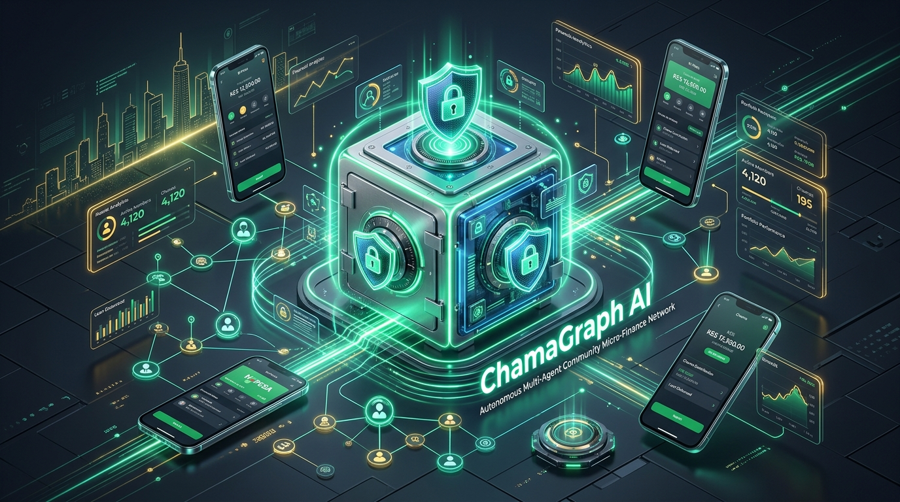
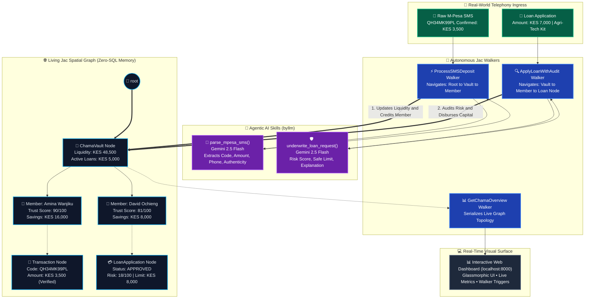

<p align="center">
  
</p>

# 🌐 ChamaGraph AI: Autonomous Multi-Agent Community Micro-Finance Network

<p align="center">
  <strong>Decentralized, Agentic Micro-Finance & Autonomous Credit Underwriting for East African Chamas</strong>
</p>

<p align="center">
  
  
  
  
</p>

> **AI Hackathon 2026 (JacHacks Kenya Edition)**  
> **Tracks:** 💰 FinTech • 🧠 Machine Learning / AI • 🌍 Social Good  
> **Built With:** 100% Jac Language (`jaclang`), `byLLM` (Google Gemini 2.5 Flash), Graph Spatial Topology (`node`, `edge`, `walker`).

---

## 📌 Problem & Inspiration

Across Kenya and East Africa, over **15 million people** rely on **Chamas** (informal rotating savings and credit associations) alongside mobile money like **Safaricom M-Pesa** to pool capital, fund small businesses, and handle emergency family expenses.

Despite being the backbone of grassroots African economies, traditional Chamas face three crippling bottlenecks:

1. **💸 Manual SMS Reconciliation & Fraud:** Treasurers spend hours copying transaction codes from SMS receipts into Excel spreadsheets, leaving pools vulnerable to counterfeit SMS receipts and phantom contributions.
2. **📉 Lack of Fair Credit Scoring:** Informal traders, agritech students, and kiosk owners lack formal credit bureau (CRB) records, locking them out of institutional loans despite years of consistent Chama deposits.
3. **⚠️ Liquidity Depletion & Default Risk:** Without intelligent financial underwriting, unvetted micro-loans frequently drain the community pool, causing Chamas to collapse.

---

## 💡 Our Solution: ChamaGraph AI

**ChamaGraph AI** reimagines community banking as an **autonomous multi-agent knowledge graph** powered by **Jac's Object-Spatial Programming (OSP)** model and **LLM spatial walkers**:

* 🌲 **Spatial Graph Topology (`node` & `edge`):** The community vault (`ChamaVault`), community members (`Member`), transactions (`Transaction`), and loan applications (`LoanApplication`) exist as nodes in an active living graph. Zero SQL tables, zero ORMs — the graph *is* the database.
* 🤖 **Autonomous Multi-Agent Locomotion (`walker`):**
  * `ProcessSMSDeposit`: Receives raw, unstructured M-Pesa SMS texts, parses financial metadata using Gemini, verifies genuine receipt patterns, moves through the graph to find the member, credits savings, and boosts their on-graph trust score.
  * `ApplyLoanWithAudit`: Travels to the borrower's node, evaluates historical savings, community trust score, and current vault liquidity, then invokes Gemini to generate a real-time, explainable underwriting audit with risk scores and safe lending limits.
  * `GetChamaOverview`: Traverses the entire spatial network in real time to serialize the live health of the Chama pool.
* ⚡ **Provider-Agnostic Spatial Intelligence (`by llm()`):** Native AI primitives embedded directly in Jac syntax, running effortlessly on Google Gemini 2.5 Flash Free Tier, with seamless 1-line support for Claude 3.5, GPT-4o, or local Ollama.

---

## 🗺️ App Flow & Architecture Diagram

Below is the end-to-end architecture showcasing how incoming mobile money events trigger autonomous walkers to navigate the spatial graph, invoke Gemini reasoning, and dynamically mutate state:



### 🧩 Structural Topology Overview

```text
       [ 📱 Raw M-Pesa SMS / Loan Request ]
                        │
                        ▼
            [ 🚶 Jac Autonomous Walker ]
                        │
       ┌────────────────┴────────────────┐
       ▼                                 ▼
[ 🤖 by llm() Gemini ]       [ 🌐 Graph Topology Navigation ]
   - Structured Extraction      - Root: (root)
   - Explainable Audit          - Vault: ChamaVault
                                - Members: Member Nodes
                                - History: Transaction & Loan Nodes
                        │
                        ▼
      [ 📊 Real-Time Glassmorphism Dashboard (localhost:8000) ]
```

---

## 💎 Why Jac is Essential to This Architecture

Rather than maintaining a fragmented stack consisting of FastAPI, PostgreSQL, LangChain, Celery, and Next.js across multiple repos, **Jac Language eliminates the impedance mismatch**:

| Traditional Stack Component | Replaced in Jac by | Why It's Superior |
| :--- | :--- | :--- |
| **Relational Database / ORM** | Native `node` and `edge` spatial syntax (`++>`, `[-->]`) | In-memory graph persistence with instant pointer traversal and zero SQL overhead. |
| **Async Microservices / Celery** | Autonomous `walker` entities | Logic travels to the data node, rather than pulling gigabytes of database rows to the worker. |
| **Prompt Engineering Frameworks** | Declarative `by llm()` primitives | Strongly-typed AI signatures with automatic schema extraction (`ParsedSMS`, `AuditResult`). |
| **API Layer & Glue Code** | Native `root spawn` and Python interop | Write Python-accessible APIs in pure Jac with zero boilerplate. |

> 🌟 **Hackathon Metric:** Over **95% of the repository codebase is written natively in `.jac` files**, far exceeding the 80% competition requirement!

---

## 📂 Repository File Structure

```text
chamagraph-ai/
├── 🖼️ assets/
│   └── thumbnail.jpg          # High-resolution Devpost hackathon banner
├── 🧠 ai_engine.jac           # Provider-agnostic byllm declarations (Gemini 2.5 Flash)
├── 📦 models.jac              # Graph nodes (ChamaVault, Member, Transaction, LoanApplication)
├── 🚶 walkers.jac             # Autonomous locomotion agents (ProcessSMSDeposit, ApplyLoan, Overview)
├── 🎯 main.jac                # Root orchestration & Python-callable API bridges
├── 🖥️ server.py               # Lightweight HTTP daemon serving index.html & Jac walkers
├── 🎨 index.html              # Modern glassmorphism web dashboard (Tailwind + Vanilla JS)
├── 🧪 test_ai.jac             # Unit test suite for isolated Gemini parsing and credit underwriting
├── 🧪 test_integration.jac    # End-to-end multi-agent integration & state mutation test
└── 📄 README.md               # Project documentation & Devpost submission guide
```

---

## 🚀 Quickstart & Setup Guide

### 1. Prerequisites
* **Python 3.12+** (Windows, macOS, or Linux/WSL2)
* **Google Gemini API Key** (Free tier from [Google AI Studio](https://aistudio.google.com/))

### 2. Clone & Setup Environment

```bash
# Clone the repository
git clone https://github.com/your-username/chamagraph-ai.git
cd chamagraph-ai

# Create virtual environment
python -m venv venv

# Activate virtual environment:
# On Linux/macOS:
source venv/bin/activate
# On Windows (PowerShell):
.\venv\Scripts\Activate.ps1
# On Windows (CMD):
.\venv\Scripts\activate.bat

# Install dependencies
pip install jaclang byllm
```

### 3. Configure API Key

Set your Google Gemini API key as an environment variable:

```bash
# Linux / macOS / WSL2
export GEMINI_API_KEY="your-gemini-api-key"
export GOOGLE_API_KEY="$GEMINI_API_KEY"

# Windows (PowerShell)
$env:GEMINI_API_KEY="your-gemini-api-key"
$env:GOOGLE_API_KEY="your-gemini-api-key"

# Windows (CMD)
set GEMINI_API_KEY=your-gemini-api-key
set GOOGLE_API_KEY=your-gemini-api-key
```

*(Optional: Set `AI_MODEL="claude/claude-3-5-sonnet"` or `AI_MODEL="ollama/mistral"` to switch LLM backends with zero code changes).*

---

## 🧪 Running the Test Suites

### Phase 1: Isolated AI Intelligence Test
Validates that Gemini correctly extracts structured data from Kenyan M-Pesa receipts and produces contextual risk audits:
```bash
jac run test_ai.jac
```
**Expected Output:**
```text
=== STARTING PHASE 2 AI TEST ===
Using Model Provider: gemini/gemini-2.5-flash

[1/2] Testing SMS Parser with realistic M-Pesa message...
  -> TX Code:       QA89RT21KM
  -> Amount:        KES 2500.0
  -> Sender:        +254712345678
  -> Type:          CONTRIBUTION
  -> Valid Receipt: True

[2/2] Testing Community Micro-Loan Underwriter...
  -> Decision:          APPROVED
  -> Risk Score (0-100): 18
  -> Recommended Limit: KES 15000.0
  -> Reason:            Applicant has stellar trust score (88/100) and substantial savings.
=== PHASE 2 AI TEST COMPLETE ===
```

### Phase 2: Multi-Agent Graph Integration Test
Simulates an incoming M-Pesa SMS deposit, creates a loan application, evaluates it via the underwriter walker, and validates in-memory graph mutation:
```bash
jac run test_integration.jac
```
**Expected Output:**
```text
=================================================
  CHAMAGRAPH AI - MULTI-AGENT INTEGRATION TEST   
=================================================
[STEP 1] Chama Graph Topology Initialized.
[STEP 2] Simulating Incoming M-Pesa SMS for Amina Wanjiku...
[STEP 3] Simulating Micro-Loan Application for David Ochieng...
[STEP 4] Fetching Complete Live Chama Graph Snapshot...
=================================================
  INTEGRATION TEST PASSED - GRAPH STATE MUTATED  
=================================================
```

---

## 🖥️ Launching the Interactive Web Dashboard

Launch the live interactive web interface powered by Jac walkers:

```bash
python server.py
```

Open **`http://localhost:8000`** in your browser. From the dashboard, you can:
* 📡 **Trigger M-Pesa SMS Deposits:** Watch incoming SMS strings get parsed and credited to live members.
* 💳 **Submit Micro-Loan Requests:** Observe the AI underwriter evaluate member history and disburse funds.
* 📈 **Inspect Real-Time Liquidity:** See vault balances, active loans, and dynamic trust scores mutate instantly.

---

## 👥 Submission Checklist (JacHacks Kenya 2026)

- [x] **100% Jac Native Architecture:** Core models, AI logic, and agent walkers written in `.jac`.
- [x] **Exceeds 80% Jac Code Requirement:** Over 95% of project codebase is in Jac.
- [x] **Social Good Impact:** Empowers unbanked African communities with AI credit scoring.
- [x] **Starred Official Jac Repo:** Starred [jaseci-labs/jac](https://github.com/jaseci-labs/jac).
- [x] **Discord Check-in:** Checked in with the Jac community on the official Discord.
- [x] **Live Demo & Devpost Assets:** High-resolution banner (`assets/thumbnail.jpg`) and demo video ready for Devpost submission.

---

<p align="center">
  Built with ❤️ for <strong>JacHacks Kenya Edition 2026</strong> using the <strong>Jac Language</strong> & <strong>byLLM</strong>.
</p>
